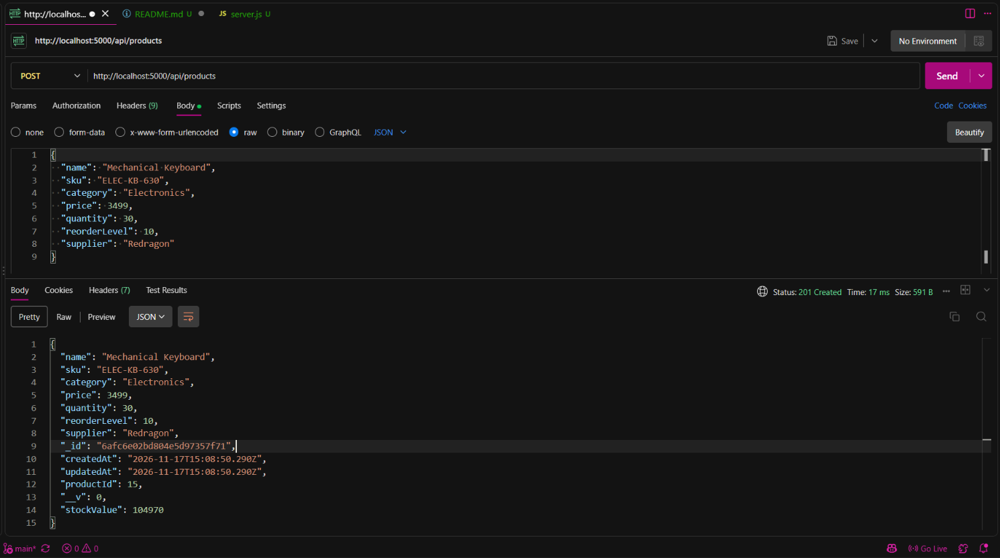
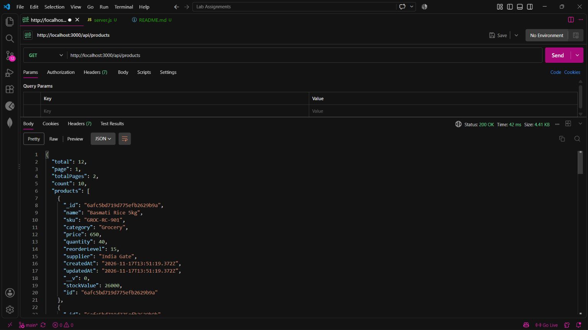
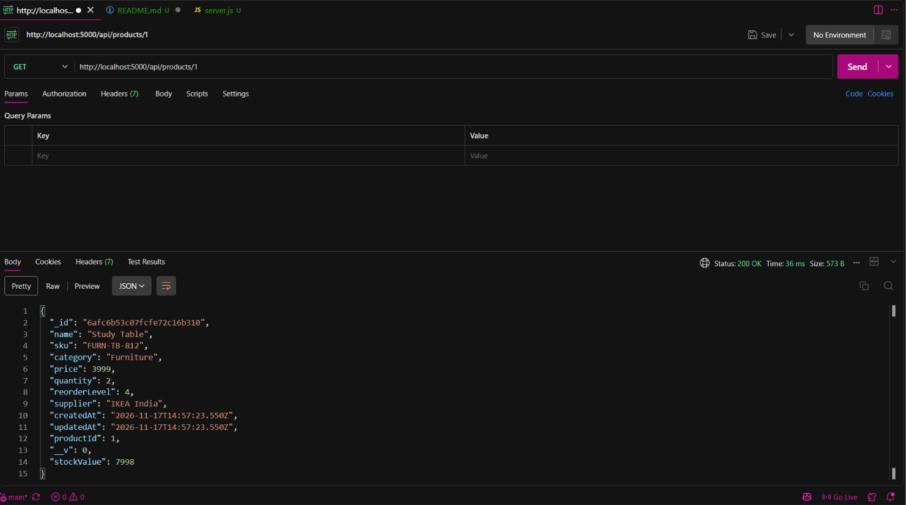
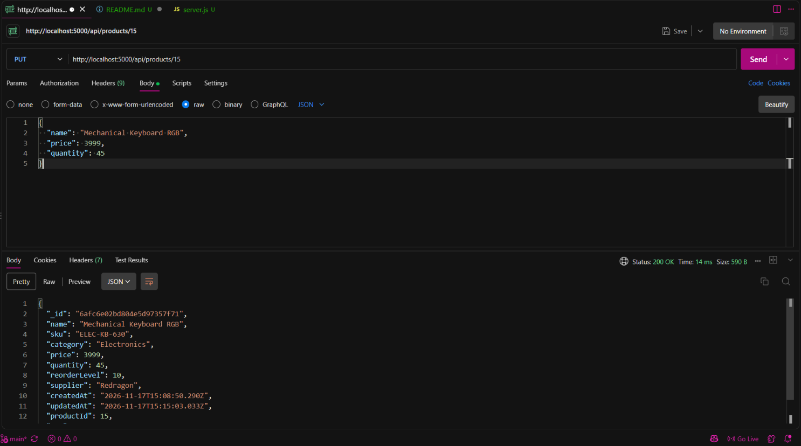
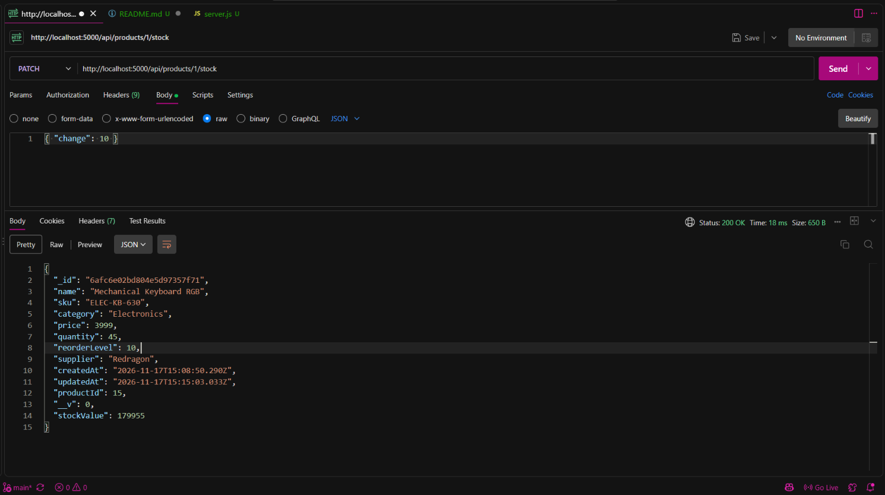
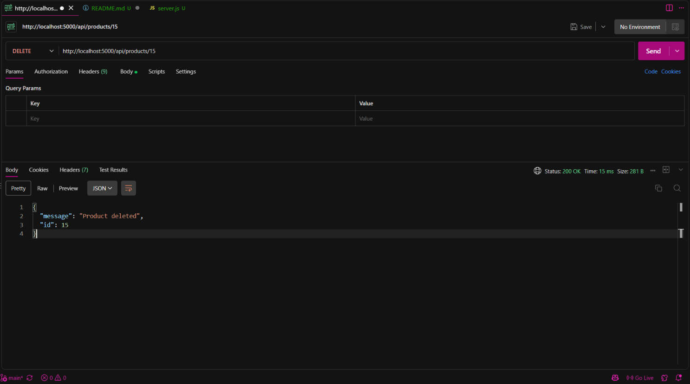
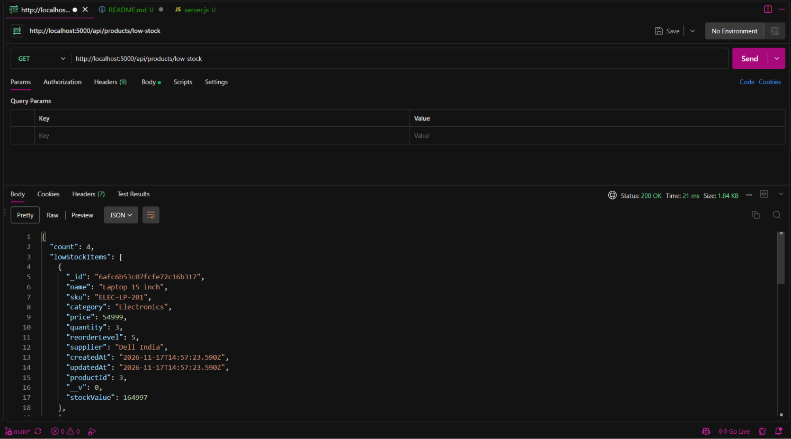
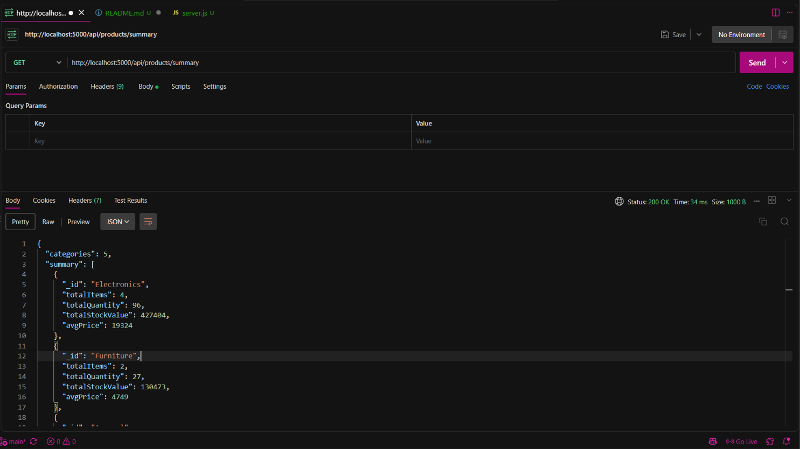

# Inventory and Data Management System

## API Endpoints

### POST /api/products – Create product

### GET /api/products – List (filter, sort, paginate)

### GET /api/products/:id – Get one product

### PUT /api/products/:id – Update product details

### PATCH /api/products/:id/stock – Restock / sale
Body: `{"change": 10}`

### DELETE /api/products/:id – Delete product

### GET /api/products/low-stock – Items where quantity <= reorderLevel

### GET /api/products/summary – Category-wise aggregation
