# Lab 4 - Secure Connect and Communication Platform

Node.js + Express backend with JWT auth, bcrypt, RBAC, an owner-scoped Notes API, EventEmitter events and a Socket.IO chat.

## API

Send the token as `Authorization: Bearer <token>`. No token returns `403`, a bad or expired token returns `401`. Emails in `ADMIN_EMAILS` get the `admin` role at signup.

**POST /api/auth/signup** - register

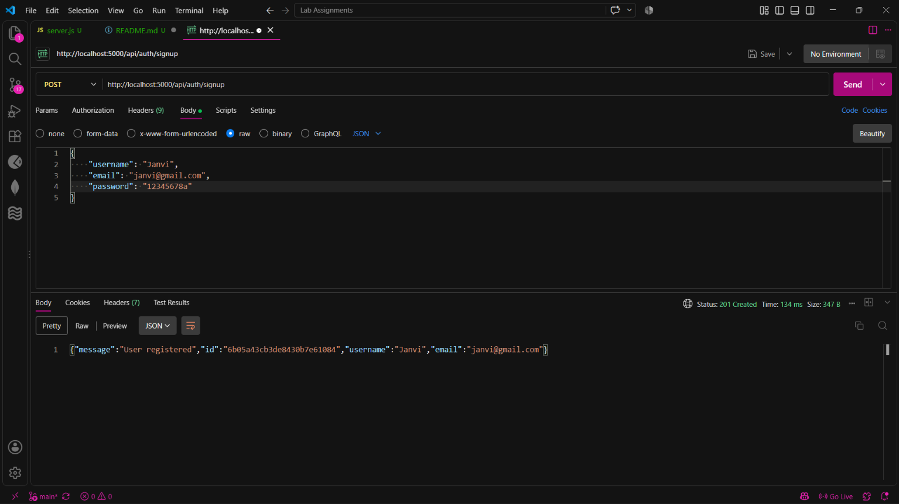

**POST /api/auth/login** - returns `{ message, token }`

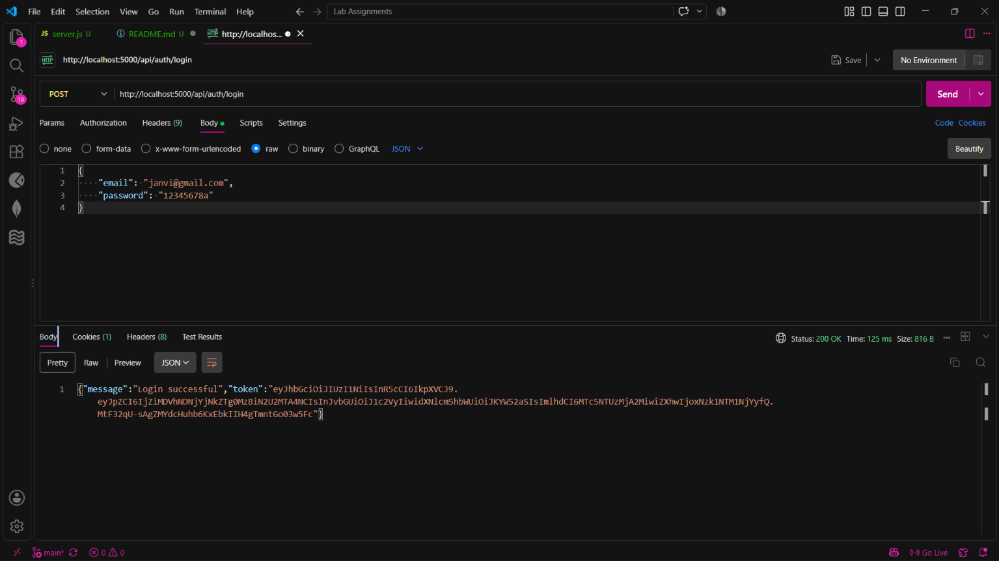

**POST /api/auth/logout** - log out

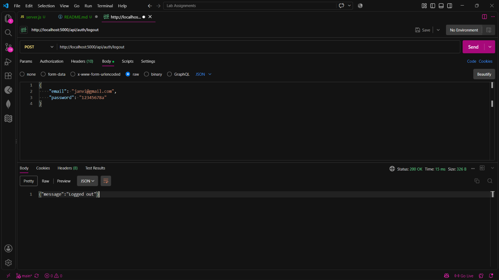

**GET /api/auth/me** - current user (JWT)

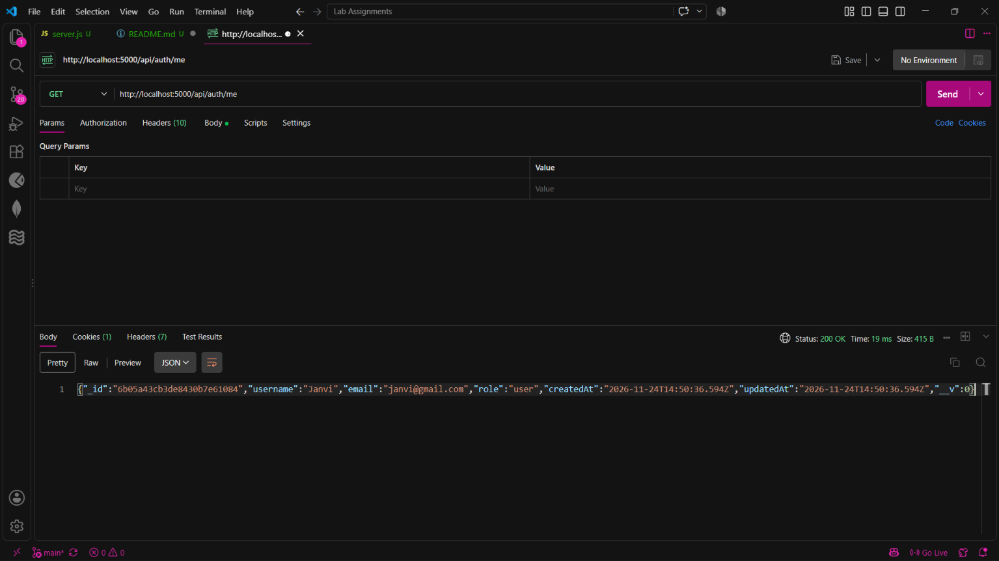

**POST /api/notes** - create note (JWT)

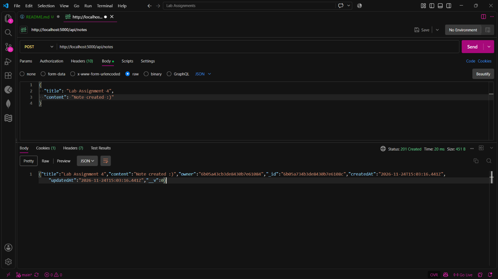

**GET /api/notes** - list own notes (JWT)

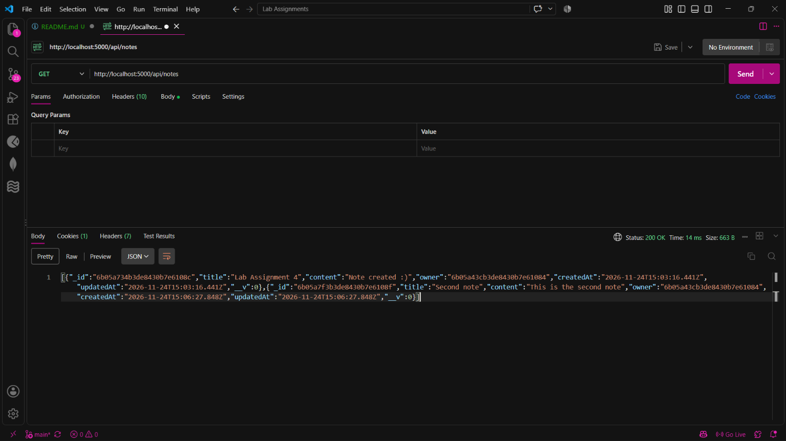

**GET /api/notes/:id** - get one note (JWT)

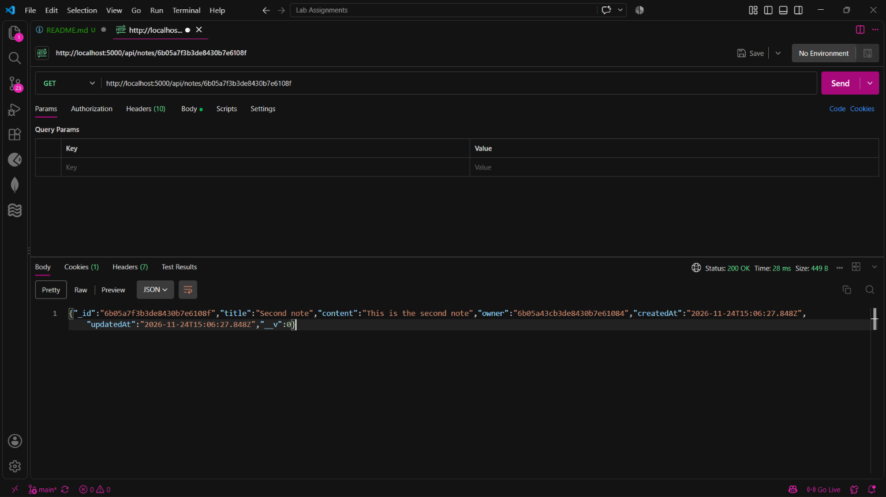

**PUT /api/notes/:id** - update note (JWT)

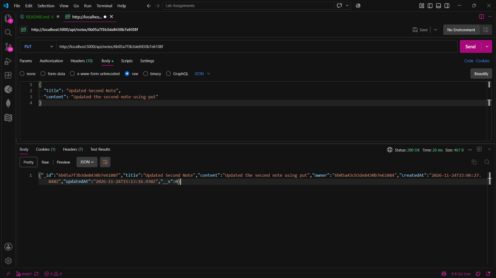

**DELETE /api/notes/:id** - delete note (JWT)

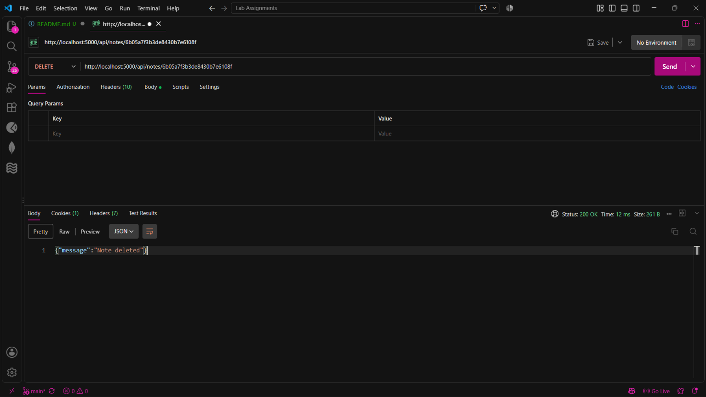

**GET /api/admin/users** - list users (JWT + admin)

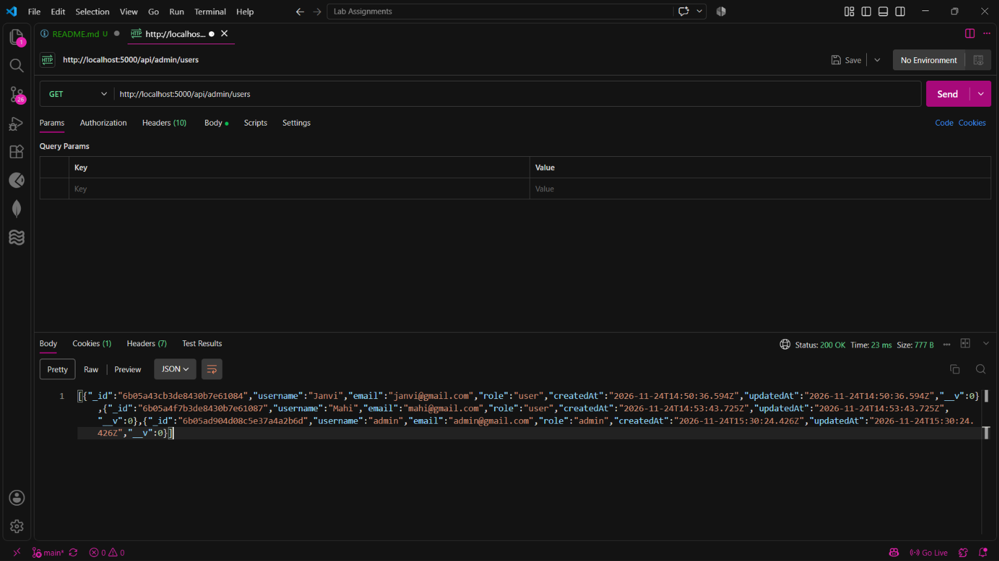
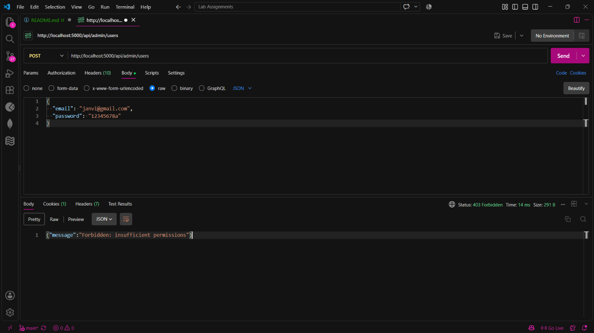

## Socket.IO

Connect with `io({ auth: { token } })`. Events: `join_room`, `leave_room`, `chat_message { room, text }`, `typing { room }`. Everyone auto-joins `general`.

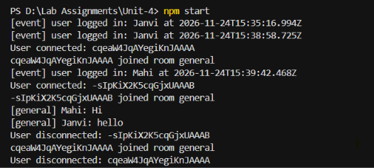

## EventEmitter

`events/appEvents.js` emits `user:registered`, `user:loggedIn` and `note:created|updated|deleted`; note events are also pushed to the owner's sockets.

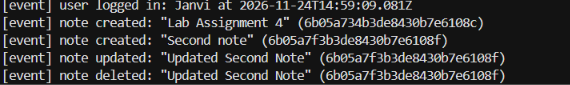